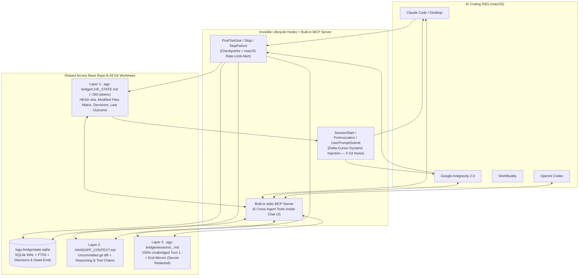

# ⚡️ `agy-bridge` — Zero-Terminal Cross-Agent Context Bus (`v0.3`)

**Switch between Claude Code / Desktop, Google Antigravity 2.0, OpenAI Codex, and WorkBuddy mid-task — without losing context, git worktrees, or ever opening Terminal.**

[](https://github.com/phazww/agy-bridge/releases)
[](./LICENSE)
[-green.svg)](./agy-bridge)
[](#)

---

## Why `agy-bridge`?

When you hit a rate limit mid-task in **Claude Code**, or switch to **Antigravity 2.0** / **Codex** for a second opinion, three things usually break:
1. **Context Amnesia**: The new agent doesn't know what files the previous agent touched, what approaches already failed (`dead_end`), or why specific workarounds were written.
2. **Worktree Fragmentation**: Claude Desktop creates isolated git worktrees (`.claude/worktrees/<name>`), while Antigravity or Codex opens the base repo.
3. **Noisy `git status` or Truncated Summaries**: Dumping raw transcripts burns your token budget, while auto-appending state into tracked `CLAUDE.md` / `AGENTS.md` pollutes `git status` on every single turn.

`agy-bridge v0.3` solves all three **with zero Terminal commands required during your workflow**:
- **Invisible Lifecycle Hooks** (`SessionStart`, `UserPromptSubmit` / `PreInvocation`, `PostToolUse`, `Stop`, `StopFailure`) checkpoint progress after every file edit and rate-limit crash.
- **Zero Git Noise**: Tracked `CLAUDE.md` and `AGENTS.md` stay **100% clean**. A ~350-token Progress State is dynamically injected into agent memory only when another IDE actually changed state (**0 extra tokens** on normal mid-session turns via a SHA-256 delta cursor).
- **Shared SQLite WAL + FTS5 Across All Worktrees**: Stored once in `$(git rev-parse --git-common-dir)/agy-bridge/state.sqlite` with `fcntl.flock` concurrency safety, linking all `.claude/worktrees/<name>` with the base repository and tracking uncommitted diffs, architectural decisions, failed dead-ends, and open questions.
- **Active Dev Servers & Port Detection**: Automatically detects running local dev servers (`localhost:3000 (node, PID 12345)`) bound to the project or active worktree so the next agent never spawns a duplicate server on a busy port.
- **Compose Pre-flight (before `docker compose up`)**: runs `docker compose config --format json` (1.5s timeout, cached by compose/`.env` mtime, only on SessionStart/Stop) and flags `⛔` when a published host port is already taken by a neighbor worktree or another process — so the bind never fails. `AGY_BRIDGE_NO_DOCKER=1` disables it.
- **Foreign Port Holders**: reads only `*PORT*` keys from `.env` files (numeric values, nothing else) and warns `⚠️` when a port the project needs is held by an unrelated process outside the repo (e.g. a Homebrew Postgres on 5432), without listing any other foreign listeners.
- **Built-in MCP Server (`agy-bridge mcp`, <180 tokens schema)**: Just tell any IDE in plain chat *"continue where Claude stopped"* or *"check what the other agent did"* — the agent calls the native MCP tool automatically.

---

## Architecture: 3-Layer Lossless Context + Dynamic Hook Injection



---

## Quick Install (1 Command, Zero Dependencies)

Requires macOS and Python 3.9+ (uses **100% Python standard library** — no `pip install` or `venv` needed).

```bash
git clone https://github.com/phazww/agy-bridge.git
cd agy-bridge
./install.sh
```

What `./install.sh` (`agy-bridge install-hooks`) configures automatically:
1. **Binaries**: Installs `agy-bridge` and short alias `ab` into `~/.local/bin/`.
2. **Claude Hooks**: Registers `SessionStart`, `UserPromptSubmit`, `PostToolUse` (`Edit|Write|MultiEdit`), `Stop`, and `StopFailure` in `~/.claude/settings.json`.
3. **Antigravity 2.0 Plugin**: Installs `~/.gemini/config/plugins/agy-bridge/` (`SessionStart`, `PreInvocation`, `PostToolUse`, `Stop` hooks + rules + MCP).
4. **MCP Server Across All IDEs**: Registers `agy_bridge` (`agy-bridge mcp`) in Antigravity (`mcp_config.json`), Claude (`~/.claude.json`), and Codex (`~/.codex/config.toml`).

---

## Zero-Terminal Workflow (Inside Any IDE Chat)

Once installed, you **never need to open Terminal** to sync or switch IDEs:

1. **Automatic Sync**: Work normally in Claude, Antigravity, or Codex. Every file edit (`PostToolUse`) and turn completion (`Stop`) updates the 3 context layers in the background.
2. **Rate-Limit / Crash Protection (`StopFailure`)**: If Claude hits a rate limit mid-run, `agy-bridge` captures the interrupted state and triggers a native macOS Notification.
3. **Ask in Plain Text Inside Chat**:
   - *"Continue the task where Claude stopped"* → calls `bridge_continue_task`
   - *"What did the other agent change in this repo?"* → calls `bridge_get_state`
   - *"Search previous sessions for how we configured CORS"* → calls `bridge_search_history` (SQLite `FTS5`)
   - *"Record that approach X failed because of Y so other agents don't repeat it"* → calls `bridge_record_decision` (`kind="dead_end"`)
   - *"Send this update to the open Claude Desktop tab"* → calls `bridge_send_to_claude` (via `/tmp/cc-socks/<pid>.sock`)
   - *"Open a new Antigravity Turbo chat for this project"* → calls `bridge_spawn_agy_chat`

---

## Built-in MCP Tools (`agy-bridge mcp`)

| MCP Tool | Description |
| :--- | :--- |
| `bridge_get_state` | Returns the live ~350-token Progress State, modified files matrix, multi-worktree `git status`, active dev servers/ports, `StopFailure` alerts, and recorded decisions/dead-ends/open-questions. |
| `bridge_continue_task` | One-step failover: auto-detects the latest active or interrupted session across IDEs, syncs all 3 layers + running dev servers, and continues in the current or target IDE. |
| `bridge_record_decision` | Records an architectural `decision`, rejected `dead_end`, or `open_question` in `<git-common-dir>/agy-bridge/state.sqlite` with `HEAD sha` attribution. |
| `bridge_search_history` | Instant SQLite `FTS5` full-text search across all unabridged session transcripts of the project. |
| `bridge_send_to_claude` | Injects a prompt directly into a live open Claude Desktop / CLI tab via Unix domain socket (`/tmp/cc-socks/<pid>.sock`). |
| `bridge_spawn_agy_chat` | Registers the project in Antigravity 2.0 (with Turbo / Allow / Eager policies) and spawns + focuses a live chat tab. |

---

## Optional CLI Reference (`ab` / `agy-bridge`)

If you also like using the CLI or keyboard shortcuts (Raycast / Alfred):

```bash
# One-step failover: auto-detect latest active/interrupted project & continue in another IDE
ab continue
ab to agy
ab to claude

# Health check of Antigravity daemon, hooks, MCP servers, and live sockets
ab doctor

# View all active projects, git worktrees, and live sessions across all 4 IDEs
ab status
ab sockets

# Manually run 3-layer lossless sync on a project
ab sync ~/Documents/my-project

# Cleanly remove all global hooks and plugin files
ab uninstall
```

---

## Security & Privacy by Design

- **Automatic Secret Redaction (`redact_secrets`)**: Strips `.env` assignments (`*_KEY`, `*_SECRET`, `*_TOKEN`, `*_PASSWORD`), `sk-ant-...`, `sk-...`, `ghp_...`, `github_pat_...`, `AIza...`, `xox[baprs]-...`, and `Bearer` tokens before writing session mirrors or SQLite FTS indexes.
- **Atomic `0600` Writes & File Locking**: Uses `fcntl.flock` (`<git-common-dir>/agy-bridge/bridge.lock`) and atomic temp-file `os.replace` with `chmod 0600`.
- **100% Local**: Zero external network calls, zero telemetry. Everything stays on your Mac.

---

## License

[MIT](./LICENSE) © 2026 [phaz (`@phaz_dev`)](https://x.com/phaz_dev)
